<div align="center">



[](#install)
[](WoofPhoto)
[](https://immich.app)

**A native iPhone client for your Immich server.**
Browse, edit and back up your photos in an app that mixes Photos and WoofMusic.

</div>

## Highlights

| | |
| --- | --- |
| 🖼️ **One library** | Photos on the server and on the iPhone share one grid, with a badge on items not backed up yet. |
| ✏️ **Full editor** | Sliders, filters, crop, markup, Clean Up and video trim. Edits save to the server and can be reverted. |
| 🔎 **Smart search** | Results appear as you type, with filters and text found by OCR. |
| ☁️ **Background backup** | Pick device albums, upload over Wi-Fi or cellular, then free up space. |
| 🧊 **Native iOS 26** | Zoom transitions, system menus and sheets. Hidden items stay behind Face ID. |

## Features

- **Library.** One grid for photos on the server and on the iPhone. Pinch for density, Years / Months / All, a scrubber by month, a badge on items not backed up yet.
- **Viewer.** Zoom transition from the grid, paging, pinch and double-tap zoom, video, Live Photos (touch and hold), Live Text, info panel with map and caption.
- **Editor.** Adjust sliders, Auto, filters, crop and straighten, markup, Clean Up, video trim, Live Photo key frame. Edits save to the server and can be reverted.
- **Collections.** Albums, shared albums, People, Pets, Places, Memories and memory movies, Trips, media types, Utilities (receipts, QR codes), Duplicates, Archive, Recently Deleted, Hidden behind Face ID.
- **Search.** Smart search as you type, suggestions, filters, text found by OCR.
- **Backup.** Choose device albums, upload in the background, Wi-Fi or cellular, free up space after upload.
- **Also.** Featured Photos widget, "Upload to Immich" share extension, offline viewing, OAuth sign-in.

## Install

You need iOS 26 or later.

1. Open the **Actions** tab of this repository and run the **Native app** workflow.
2. Download the `WoofPhoto-native` artifact from the finished run. It holds `WoofPhoto.ipa` and expires after one day.
3. Sign and install it with FlareStore. Keep the bundle ID `com.laskywolf.woofphoto`.

## Build on a Mac

You need Xcode 26 and [XcodeGen](https://github.com/yonaskolb/XcodeGen).

```bash
brew install xcodegen
xcodegen generate && open WoofPhoto.xcodeproj
```

`WoofPhoto.xcodeproj`, the Info.plist files and the entitlements files are generated from `project.yml`. Do not commit them.

## Diagnostics

Sign in with your server address, email and password. The account button opens the diagnostics screen:

- **Count Timeline** shows the number of months and items.
- **Write Value for the Widget** feeds the **WoofPhoto Check** widget. It passes when it shows the same time and group as the app.
- **Open a Live Photo from the Server** passes when the photo plays while you touch and hold it.
- **AI Models** times the on-device models and shows their peak memory.

## Tech stack

- Swift 5 mode, SwiftUI, Liquid Glass, iOS 26 deployment target.
- WidgetKit and a Share extension, linked to the app by an App Group.
- Vision, VisionKit, Core ML and PencilKit.
- XcodeGen for the project, GitHub Actions on `macos-26` for the build.
- A small hand-written client for the Immich API (`ImmichClient.swift`).

## Project structure

```
WoofPhoto/          the app: views, editor, backup, offline store
Shared/             code shared by the app and both extensions
WoofPhotoWidget/    Featured Photos widget
ShareExtension/     "Upload to Immich" share extension
project.yml         XcodeGen project definition
```
